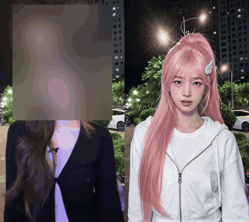
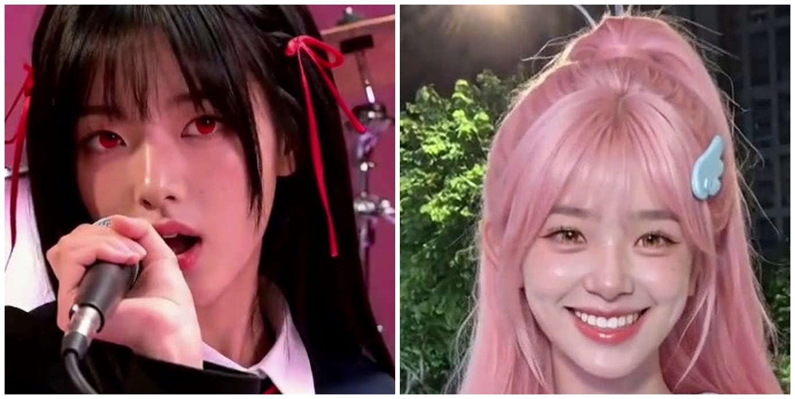

# mv-swap：一键 AI 换人翻拍

给一条高清原片（MV、舞蹈、影视片段）和几张角色图，说清楚「原片里的谁换成哪张图里的人」，它自己切镜头、认人、在 RunningHub 上用 MiniMax H3 换人生成、审片、重跑、超分、拼片，出成片、上下对照片和一份成本报告。

做法来自我们在 RunningHub 上做的几条换人片：15 秒的闺蜜手势舞、97 秒的《APT.》MV、18 秒的饭撒摇接力。踩过的坑都写进了代码，下面「它怎么做」一节一条条讲。

```bash
python mvswap.py run jobs/apt --source mv.mp4 --start 0 --end 97 \
  --cast "金发女生=cast/girl.jpg" --cast "戴黑帽墨镜的男生=cast/boy.jpg"
```

## 效果

左边是原片（原作者的脸打了码），右边是换人后的成片。一条 9 秒的 1080p 单人舞蹈，用这个仓库的代码一次过审，生成 ¥0.29、超分 ¥0.18，21 分钟出片。点图看原视频（有声）。

[](docs/media/swap-compare.mp4)

## 准备

1. **Python 3.10+、ffmpeg**（`brew install ffmpeg` / `apt install ffmpeg`），然后 `pip install -r requirements.txt`。想直接贴视频链接的话再装 `yt-dlp`。
2. **两个 key**，复制 `.env.example` 成 `.env` 填上：
   - `RUNNINGHUB_API_KEY`：[RunningHub](https://www.runninghub.cn) 控制台「API 调用」里拿。会员 key 一次跑 5 个任务、扣 RH 币；企业 key 扣钱包、能同时跑很多个，`RUNNINGHUB_CONCURRENCY` 开大。几个 key 用逗号隔开会一起用。
   - `APIMART_API_KEY`：[APIMart](https://apimart.ai)，认人和审片用它的 Gemini 3.8 Flash，平面图形镜头重画用 GPT Image 2.5。想换别家视觉模型，配 `VISION_BASE_URL` / `VISION_API_KEY` / `VISION_MODEL`（OpenAI 兼容接口都行）。
3. **一条高清原片**：720p 以上，最好 1080p 的本地文件。链接也行（走 yt-dlp），但很多网站游客只给低清，低于 720p 工具会停下；确认就用低清时加 `--allow-lowres`，成片会糊。

   

   同样放大看：左边是 360p 原片换出来的，头发和皮肤糊成一片；右边是 1080p 原片换出来的。

4. **角色图**：每个新角色一张，全身、穿着成片里要穿的那套衣服、背景干净。真人原片配真人照片；动画原片要先按原片画风重画角色，画风才接得上。

用 Claude Code 或 Codex 的话，把这个仓库放进 skills 目录（比如 `~/.claude/skills/mv-swap`），直接说「把这条 MV 里的金发女生换成这张图里的人」，它会照 `SKILL.md` 来跑。

## 用法

```bash
python mvswap.py run jobs/<任务名> --source <文件或链接> --cast "原片里的人=角色图" [--cast …] [--start 秒 --end 秒]
python mvswap.py run jobs/<任务名>        # 断了就原样再跑：参数记在任务目录的 state.json 里，跑过的不重跑，在跑的接着查
python mvswap.py status jobs/<任务名>     # 到哪一步、每个镜头的情况、花了多少
python mvswap.py assemble jobs/<任务名>   # 只重新拼片和出报告
```

`--cast` 左边是原片里的人，用中文描述到能认出来就行，写**整条片里都不变**的特征（发色、演出服），别写会变的（发型长短、扎没扎起来）：这句会变成每个镜头里找人的依据。我们有一次写了「黑色短发」，到了这个人扎起头发的后台镜头，模型就去换了旁边一个短发戴眼镜的工作人员。同性别替换最稳，男换女、女换男时报告里会提醒。

其他开关：`--crop auto|none|w:h:x:y`（默认自动裁掉上下黑边）、`--no-upscale`（不做超分）、`--max-attempts 3`、`--allow-many-graphic`。

跑完看任务目录里的 `report.md`、`final/compare.mp4`（上原片下成片）和 `final/sheet.jpg`（成片每秒一帧）。报告里「三次都没过审」的镜头要人看一眼：审片模型偏严，多数能用；真不能用的手工修，改完 `state.json` 再跑一次 `run`，它会补超分、重拼。

## 它怎么做

1. **取片**：本地文件直接用，链接走 yt-dlp。截取时间段、裁掉黑边、统一成 24fps。
2. **切镜头**：场景分数大于 0.28 先切，再用 0.12 把同色背景里漏掉的切口找出来；前后画面构图还连得上的不算切口，否则舞台闪光、频闪会把一个镜头切成好几段（一条 92 秒的片子第一次切出 104 段，加了这道后 54 段）。超过 14 秒的镜头平均切开。**一个镜头一个任务**：一段里带切镜，模型会打乱镜头顺序、自己编画面。
3. **认人**：视觉模型先把你的中文描述写成原片里每个人的英文外貌，再从角色图写出替换后的样子，顺便判断原片是真人还是动画；然后每个镜头看首、中、尾三帧，标成「换人 / 用原片（没人、字卡、只有嘴或眼睛的特写、剪影）/ 图形（贴纸、手绘这类平面画面）」，记下谁在画面里、景别、有没有字、布景和光线。
4. **生成**：每个镜头补定格尾巴凑成 17k+5 帧（这个工作流只出这种长度，抽风的结尾正好落在被剪掉的部分），放大到约 0.8MP 的同比例尺寸（16:9 是 1184×672）。单人镜头只给那个人的一张图，不然另一个人会走进画面。提示词只说谁换成谁、景别逐帧跟原片、这个镜头的布景照原片、只取图里的人不取图的底色。列道具会让它加贴纸、拉全景；提「每个切镜」它会自己加切镜；只笼统说「布景照原片」，暗场镜头常被定妆照的灰底顶掉，所以每个镜头单独写出它的布景。

   

   一条 15 秒的舞蹈整段生成，最后不到一秒突然变成了角色的定妆照。补的那截定格尾巴，就是为了把这种结尾剪掉。

5. **审片**：一道颜色检查（画面外圈和原片差太多 = 背景跑了），一道视觉模型对照原片同一时刻的三帧：景别、换对了没有、原来的人还在不在、多没多人、加没加字和贴纸、有没有崩。全都干净才算过。
6. **重跑**：没过的换种子再来；最好的一次只换掉了一部分人时，下一次拿这次的结果当原片，只给没换掉的人再过一遍。最多 3 次，挑分最高的。
7. **图形镜头**：视频模型做不了平面图形，就用 GPT Image 把中间那帧按原来的风格重画成新角色，再慢慢推近撑满时长。
8. **超分**：过审的镜头在 RunningHub 上过一遍 SeedVR2，短边放大到成片尺寸，再按原镜头的颜色校一次（放大后整体偏品红）。
9. **拼片**：每个镜头按原片的帧数取用，放大到长边 1920，原声配回去，出成片、对照片、缩略图和报告。

## 成本和时间（实测）

| 片子 | 镜头 | RunningHub | 生图 / 视觉 | 墙钟 |
|---|---|---|---|---|
| 22 秒 MV 片段（换人 9、原片 2、图形 3） | 14 | ¥1.06 | ¥1.48 / ¥0.1 | 24 分钟 |
| 9 秒 1080p 单人舞蹈（用这个仓库的代码，含超分） | 1 | ¥0.29 + 超分 ¥0.18 | — / ¥0.06 | 21 分钟 |

一条 92 秒、54 个镜头的三维动画 MV，按现在的代码重跑约 ¥23（生成 ¥14、超分 ¥4.2、视觉 ¥4.9）、50 分钟左右。换人镜头每秒约 ¥0.05（会员币）到 ¥0.1（企业钱包），Seedance 2.0 mini 480p 是每秒 ¥0.1 左右。一条 1 分半的 MV 大约 45 个换人镜头，钱包够让它们一起跑的话，半小时左右、¥10 上下。企业钱包按每个在跑的任务预扣一点余额，余额不够时新任务会被拒，工具会等空位再交。

动画原片能跑通，但我们自己看下来效果不如真人 MV 和舞蹈，优先选真人原片。

## 文件

- `mvswap.py` 命令入口；`mvswap/pipeline.py` 各阶段和状态；`rh.py` RunningHub（取节点图、排队、预扣满了等空位、断线重试、续跑接着查）；`ai.py` 视觉模型和生图；`media.py` 取片、切镜头、补帧；`vision.py` 认人、打标签、审片；`prompts.py` 提示词；`cast.py` 角色；`finish.py` 图形镜头、拼片、报告。
- 用到 RunningHub 上两个公开工作流，节点图运行时用你的 key 现取（`getJsonApiFormat`），缓存在 `~/.cache/mv-swap/`，不随仓库分发：
  - Nick 的 [「MinimaxH3 swap 角色迁移」](https://www.runninghub.cn/post/2109190174289780738)（H3 换人，fl2va/ref2va 混合模型 + 换人 LoRA）
  - C-KIRIN 的 [「视频高清放大+补帧：SeedVR2」](https://www.runninghub.cn/post/1989896719183867905)
  
  作者改了工作流、节点号对不上时，工具会停下并提示。

## 许可

代码 MIT。两个工作流归各自作者；MiniMax H3 模型遵守 [MiniMax H3 Community License](https://huggingface.co/MiniMaxAI/MiniMax-H3/blob/main/LICENSE)。换人涉及真人肖像，原片和角色图的版权、肖像权请自己确认，别拿别人的脸做误导性内容。

想写原创剧情片、像 Seedance 一样「提示词 + 参考图」出片，看姊妹仓库 [h3-ref-video](https://github.com/garycaogan/h3-ref-video)。
